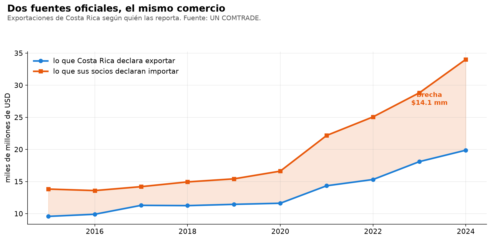
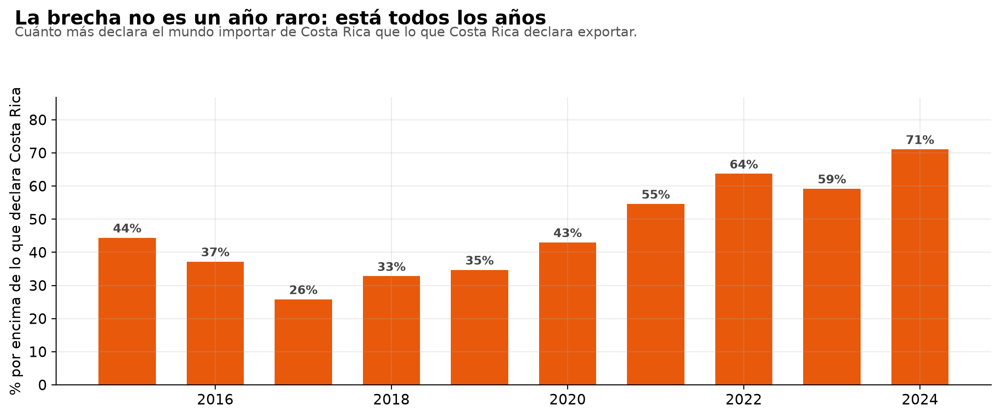
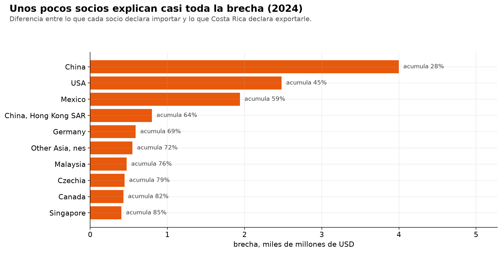
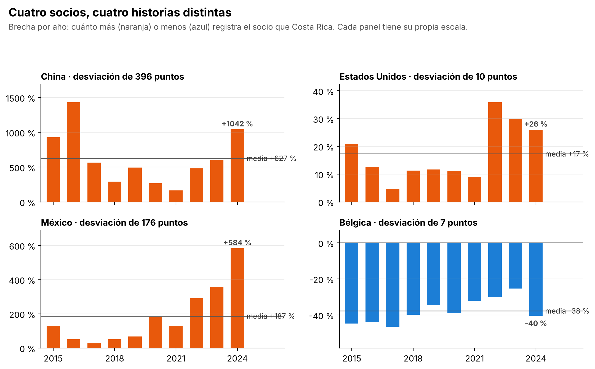

# Costa Rica and its trade partners do not report the same trade

*[Versión en español](README.md)* ·
**[Interactive dashboard →](https://pabloguerrerocr.github.io/brecha/)** (in Spanish) the gap year by year and partner by partner

**Question.** Every export is recorded twice: Costa Rica reports it as an export and
the partner reports it as an import. Do those two official figures match? And if not,
where is the difference?

**Short answer.** They do not match, and the difference keeps growing. In 2024 Costa
Rica reported $19.9 bn in exports; its partners reported importing $34.0 bn from Costa
Rica. That is a $14.1 bn difference, 71%.



That difference is called the *mirror statistic*, and customs agencies and central
banks use it to detect under-invoicing, re-exports and classification errors.

## Three findings

**1. The gap is not a one-off: it is there all ten years, and it tripled.** It never
fell below 25% and went from 44% in 2015 to 71% in 2024. In dollars it went from
$4.3 bn to $14.1 bn, and it has grown every year since 2017.



**2. Three partners explain more than half of it.** In 2024 China accounts for 28.0% of
the gap, the United States for 17.3% and Mexico for 13.6%: together, 58.9%. Ten
partners reach 84.6%.



**3. Each partner is a different phenomenon.**

| Partner | Costa Rica reports (annual average) | Mean gap | Std. dev. | Cumulative gap, 10 years |
|---|---:|---:|---:|---:|
| **China** | $220 M | **+627%** | 396 | $12.40 bn |
| **United States** | $5,795 M | **+17.3%** | 10.2 | $11.15 bn |
| **Mexico** | $289 M | **+187%** | 177 | $5.77 bn |
| **Belgium** | $705 M | **−37.7%** | 7.0 | −$2.61 bn |

- **United States: the partner reports 17% more on average** (between +5% and +36%
  depending on the year). That order of magnitude is consistent with FOB versus CIF
  valuation (the importer includes freight and insurance) plus recording lags. It is
  the "normal" gap.
- **China: +627%.** That is not freight: on average China reports importing about seven
  times what Costa Rica reports exporting to it. The hypothesis to test is origin
  attribution: free-zone goods sold to an intermediary and recorded by the destination
  as Costa Rican.
- **Mexico: the gap took off,** from 28% in 2017 to 584% in 2024.
- **Belgium is the reverse case:** Costa Rica systematically reports *more* than Belgium
  records, with a standard deviation of 7 points, the lowest among the twelve partners
  with the largest absolute cumulative gap. It is not the only one: with Nicaragua, Honduras,
  Panama, El Salvador and the Dominican Republic Costa Rica also reports more, and even
  more steadily (standard deviations of 3 to 5 points). A gap that repeats for ten years
  like that is structural, not an error.



## Data

[UN COMTRADE](https://comtradeplus.un.org/), the United Nations trade database: a public
API with no key. Total goods trade, annual, 2015-2024, in current dollars.

| Side | Who reports | What is requested |
|---|---|---|
| A | Costa Rica (code 188) | exports to each partner |
| B | every other country | imports from Costa Rica, with `customsCode=C00`, `motCode=0` and `partner2Code=0` |

Those three filters came from testing the API, not from the manual: when several
reporters are requested, the response is broken down by customs regime, transport mode
and second partner, and it cuts off at 500 records. Without them the numbers come out
wrong and you don't notice.

The world total and regional aggregates are excluded to avoid double counting. The data
is versioned in `datos/espejo.csv` (3,044 rows), so the analysis runs offline.

## Method

The whole analysis is in SQL ([`02_analisis.sql`](02_analisis.sql)) on DuckDB; Python only
downloads, orchestrates and plots. This is a reconciliation problem between two sources,
which is what SQL does best.

1. **The mirror pair**, with a `FULL OUTER JOIN` by year and partner. An `INNER` join
   would drop the partners that appear on only one side, and those are a finding too: in
   2024, 17 partners were reported only by the other country and 41 only by Costa Rica.
2. **The gap**: what the partner reports minus what Costa Rica reports, in dollars and as
   a percentage of what Costa Rica reports.
3. **Who explains it**: each partner's contribution to the year's gap, with ranking and
   running total (`SUM() OVER`, `ROW_NUMBER() OVER (PARTITION BY)`).
4. **Persistence**: mean, range and standard deviation of the gap for every partner with
   8 or more years of data and at least $20 million in average trade, sorted by amount.
5. **Data quality checks** that return the failing rows, not a boolean: 530 partners
   without a counterpart, 451 gaps above 200%, 155 cases where Costa Rica reports more
   than the partner, and 0 duplicates.

**The mistake this project almost made.** The first version of the persistence view
sorted by mean percentage gap, and the top result was **Serbia, with a gap of 20 million
percent**: Costa Rica reported a few hundred dollars and Serbia a few thousand. It was
true and useless, because a percentage means nothing when the denominator is tiny. The
view now requires a minimum trade volume and sorts by amount; the reason is documented
in the SQL itself.

## Run it

```bash
git clone https://github.com/pabloguerrerocr/brecha-espejo-cr.git
cd brecha-espejo-cr
pip install -r requirements.txt
python 03_reporte.py    # runs the SQL on the versioned data and prints the report
python 04_figuras.py    # the four figures
```

| File | What it does |
|---|---|
| `01_bajar.py` | downloads both sides of the mirror again from COMTRADE, with caching and retry on HTTP 429. Replaces `datos/espejo.csv` |
| `02_analisis.sql` | **the whole analysis**: the pairing, the gap, the contribution, persistence and the checks |
| `03_reporte.py` | runs the SQL and prints the report; leaves the database in `espejo.duckdb` |
| `04_figuras.py` | the four figures in this README |
| `EJERCICIOS.md` | ten exercises to rewrite the queries without looking (in Spanish) |

Tested with Python 3.13, DuckDB 2.0 and pandas 3.1. With DuckDB 2.0, `nanobind: leaked
...` notices may appear when `04_figuras.py` exits: they come from the library and do
not affect the results.

## Limitations

- **The gap is not decomposed.** Separating how much is FOB/CIF, how much is re-exports
  and how much is unexplained requires freight and origin data that COMTRADE does not
  publish. What can be said is that 17% is consistent with FOB/CIF and 627% is not.
- **The analysis is at the total level.** Breaking it down by chapter would show whether
  the gap is concentrated in free-zone products, which is the hypothesis.
- **COMTRADE revises its figures.** If the data is downloaded again, recent years may
  change.
