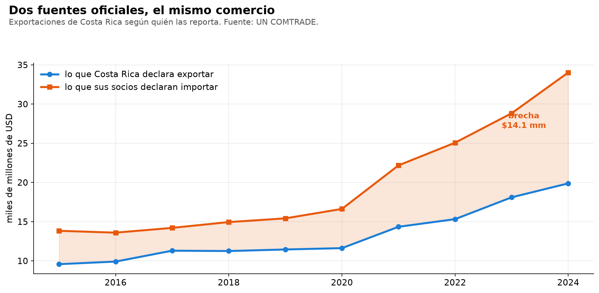
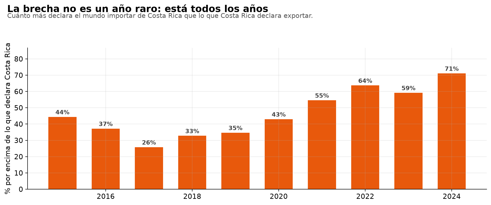
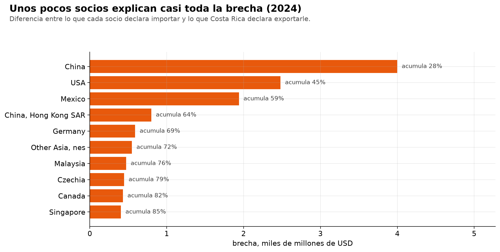
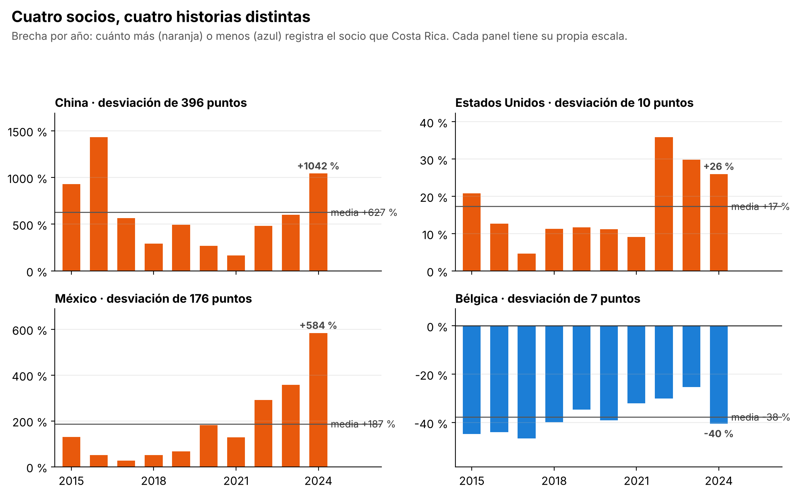

# Costa Rica y sus socios no reportan el mismo comercio

*[English version](README.en.md)* ·
**[Tablero interactivo →](https://pabloguerrerocr.github.io/brecha/)** la brecha año por año y socio por socio

**Pregunta.** Cada exportación se registra dos veces: la declara Costa Rica al exportar
y la declara el socio al importar. ¿Coinciden esas dos cifras oficiales? Y si no, ¿dónde
está la diferencia?

**Respuesta corta.** No coinciden, y la diferencia crece. En 2024 Costa Rica declaró
exportar US$19,9 mil millones; sus socios declararon haberle importado US$34,0 mil
millones. Son US$14,1 mil millones de diferencia, un 71 %.



A esa diferencia se le llama *estadística espejo*, y aduanas y bancos centrales la usan
para detectar subfacturación, reexportaciones y errores de clasificación.

## Tres hallazgos

**1. La brecha no es un año raro: está los diez años y se triplicó.** Nunca bajó de
25 % y pasó de 44 % en 2015 a 71 % en 2024. En dólares pasó de US$4,3 a US$14,1 mil
millones, y crece todos los años desde 2017.



**2. Tres socios explican más de la mitad.** En 2024 China aporta el 28,0 % de la
brecha, Estados Unidos el 17,3 % y México el 13,6 %: juntos, el 58,9 %. Con diez socios
se llega al 84,6 %.



**3. Cada socio es un fenómeno distinto.**

| Socio | Costa Rica declara (promedio anual) | Brecha media | Desviación | Brecha acumulada, 10 años |
|---|---:|---:|---:|---:|
| **China** | US$220 M | **+627 %** | 396 | US$12,40 mm |
| **Estados Unidos** | US$5.795 M | **+17,3 %** | 10,2 | US$11,15 mm |
| **México** | US$289 M | **+187 %** | 177 | US$5,77 mm |
| **Bélgica** | US$705 M | **−37,7 %** | 7,0 | −US$2,61 mm |

- **Estados Unidos: el socio declara en promedio un 17 % más** (entre +5 % y +36 % según
  el año). Ese orden de magnitud es compatible con la valoración FOB frente a CIF (el
  importador incluye flete y seguro) más los desfases de registro. Es la brecha
  «normal».
- **China: +627 %.** Eso no es flete: China declara importar, en promedio, unas siete
  veces lo que Costa Rica declara exportarle. La hipótesis a contrastar es la
  atribución de origen: mercancía de zona franca que se vende a un intermediario y que
  el destino registra como costarricense.
- **México: la brecha se disparó,** de 28 % en 2017 a 584 % en 2024.
- **Bélgica es el caso inverso:** Costa Rica declara sistemáticamente *más* de lo que
  Bélgica registra, con una desviación de 7 puntos, la menor entre los doce socios con
  más brecha acumulada en valor absoluto. No es la única: con Nicaragua, Honduras, Panamá, El Salvador y
  República Dominicana también declara más, y de forma aún más estable (desviaciones de
  3 a 5 puntos). Una brecha que se repite diez años así es estructural, no un error.



## Datos

[UN COMTRADE](https://comtradeplus.un.org/), la base de comercio de las Naciones Unidas:
API pública y sin llave. Comercio total de bienes, anual, 2015-2024, en dólares
corrientes.

| Lado | Quién reporta | Qué se pide |
|---|---|---|
| A | Costa Rica (código 188) | exportaciones a cada socio |
| B | cada país del mundo | importaciones desde Costa Rica, con `customsCode=C00`, `motCode=0` y `partner2Code=0` |

Esos tres filtros salieron de probar la API y no del manual: al pedir varios reporters,
la respuesta se desglosa por régimen aduanero, modo de transporte y segundo socio, y se
corta en 500 registros. Sin fijarlos, los números salen mal y no se nota.

Se excluyen el total mundial y los agregados regionales para no contar dos veces. Los
datos están versionados en `datos/espejo.csv` (3.044 filas), así que el análisis corre
sin conexión.

## Método

Todo el análisis está en SQL ([`02_analisis.sql`](02_analisis.sql)) sobre DuckDB; Python
solo descarga, orquesta y grafica. Es un problema de reconciliación entre dos fuentes,
y eso es lo que SQL hace mejor.

1. **El par espejo**, con `FULL OUTER JOIN` por año y socio. Con un `INNER` se perderían
   los socios que aparecen de un solo lado, y esos también son un hallazgo: en 2024
   hubo 17 socios que solo declaró el otro país y 41 que solo declaró Costa Rica.
2. **La brecha**: lo que declara el socio menos lo que declara Costa Rica, en dólares y
   en porcentaje de lo que declara Costa Rica.
3. **Quién la explica**: el aporte de cada socio a la brecha del año, con ranking y
   acumulado (`SUM() OVER`, `ROW_NUMBER() OVER (PARTITION BY)`).
4. **Persistencia**: media, rango y desviación de la brecha de cada socio con 8 o más
   años de datos y al menos US$20 millones de comercio medio, ordenada por monto.
5. **Chequeos de calidad** que devuelven las filas que fallan, no un booleano: 530
   socios sin contraparte, 451 brechas sobre 200 %, 155 casos en que Costa Rica declara
   más que el socio y 0 duplicados.

**El error que este proyecto casi comete.** La primera versión de la persistencia
ordenaba por brecha porcentual media y la encabezaba **Serbia, con una brecha de 20
millones por ciento**: Costa Rica declaraba unos cientos de dólares y Serbia unos miles.
Era cierto e inútil, porque un porcentaje no significa nada cuando el denominador es
diminuto. Por eso ahora se exige un comercio mínimo y se ordena por monto; está
documentado en el propio SQL.

## Cómo correrlo

```bash
git clone https://github.com/pabloguerrerocr/brecha-espejo-cr.git
cd brecha-espejo-cr
pip install -r requirements.txt
python 03_reporte.py    # corre el SQL sobre los datos versionados e imprime el reporte
python 04_figuras.py    # las cuatro figuras
```

| Archivo | Qué hace |
|---|---|
| `01_bajar.py` | vuelve a bajar los dos lados del espejo desde COMTRADE, con caché y reintento ante HTTP 429. Reemplaza `datos/espejo.csv` |
| `02_analisis.sql` | **todo el análisis**: el par, la brecha, el aporte, la persistencia y los chequeos |
| `03_reporte.py` | corre el SQL e imprime el reporte; deja la base en `espejo.duckdb` |
| `04_figuras.py` | las cuatro figuras de este README |
| `EJERCICIOS.md` | diez ejercicios para reescribir las consultas sin mirarlas |

Probado con Python 3.13, DuckDB 2.0 y pandas 3.1. Con DuckDB 2.0, al cerrar
`04_figuras.py` pueden aparecer avisos `nanobind: leaked ...`: vienen de la librería, no
afectan los resultados.

## Limitaciones

- **La brecha no se descompone.** Separar cuánto es FOB/CIF, cuánto reexportación y
  cuánto queda sin explicar exige datos de flete y de origen que COMTRADE no publica. Lo
  que sí se puede afirmar es que 17 % es compatible con FOB/CIF y 627 % no.
- **El análisis es a nivel total.** Desagregar por capítulo mostraría si la brecha se
  concentra en los productos de zona franca, que es la hipótesis.
- **COMTRADE revisa sus cifras.** Si se vuelven a bajar los datos, los años recientes
  pueden cambiar.
